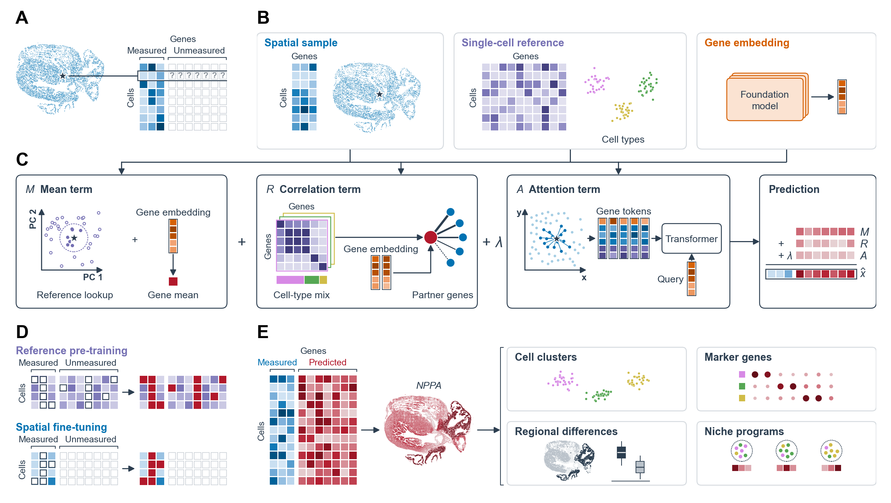

# RESONATE

<div class="hero" markdown>
**Predict genes your spatial panel did not measure.**

RESONATE predicts, in every cell of a spatial transcriptomics sample, the expression of genes outside the measured
panel. It combines expression in similar cells of a matched single-cell reference, the gene's relationships with the
measured genes, and the cell's spatial neighbours, and it represents every gene by a fixed embedding from a
single-cell foundation model.

[Get started](tutorials/demo_data.md){ .md-button .md-button--primary }
[Browse the API](api/index.md){ .md-button }
</div>

## Workflow overview



<div class="figure-caption"><strong>Figure 1. RESONATE predicts unmeasured genes from a matched reference, gene
embeddings and spatial context.</strong> (A) A spatial panel measures a few genes per cell and leaves most unmeasured.
(B) Inputs: the spatial sample, a single-cell reference of the same tissue (colours mark cell types) and a fixed vector
per gene from a pretrained foundation model. (C) The prediction for gene <em>g</em> in cell <em>c</em> is the sum of a
mean term <em>M</em>, a correlation term <em>R</em> and an attention term <em>A</em> weighted by λ. <em>M</em> averages
<em>g</em> over the reference cells nearest to <em>c</em> and adds a gene mean predicted from the embedding of
<em>g</em>. <em>R</em> weights measured partner genes by their correlation with <em>g</em> in each reference cell type,
mixed by the cell-type mix of <em>c</em>, and by both genes' embeddings. <em>A</em> turns each measured gene into a
token (its embedding, its expression in <em>c</em> and its neighbours, and the neighbours' cell-type distances) that a
transformer reads, queried by the embedding of <em>g</em>. (D) Training hides entries and reconstructs them: measured
and unmeasured genes in reference cells, then measured genes in spatial cells. A few measured genes are never targets;
they choose the checkpoint and λ. (E) The completed matrix, here predicted <em>NPPA</em> (outside the panel) on a
fetal-heart section, supports cell clustering, marker genes, and regional and niche comparisons. Matrices, clusters and
icons are schematic.</div>

## Three steps

1. **Prepare.** `resonate.prepare` normalises the counts, smooths each cell's profile over similar cells, finds the
   100 most similar reference cells of every spatial cell, clusters the reference into cell types, gives each spatial
   cell a mixture over those types, and computes type-specific gene correlations in the reference.
2. **Fit.** `resonate.fit` trains one prediction function shared by all genes in two stages: pre-training on the
   reference, where the unmeasured genes are measured, then fine-tuning on the spatial cells, where measured genes are
   hidden and reconstructed.
3. **Predict.** `model.predict` returns an `AnnData` of cells × genes for the genes you named, and, without refitting,
   for any other reference gene that has an embedding.

To measure accuracy on your own data, hold out measured genes and score them with `resonate.score_heldout`
([quick start](tutorials/quickstart.md)). See [How the model works](method.md) for the equations.

## Supported inputs

- **Spatial data**: an `AnnData` of raw counts of the measured genes, with coordinates in `obsm["spatial"]`. Each
  observation is a segmented cell, a spot or a bin; the paper covers imaging-based (MERFISH, Xenium, CosMx) and
  sequencing-based platforms. Several sections in one object are supported (`obs["section"]`).
- **Reference**: an `AnnData` of raw counts from a single-cell or single-nucleus RNA-seq study of the same tissue that
  measures the genes you want to predict; a donor column (`obs["donor"]`) is used for batch correction.
- **Gene embeddings**: one fixed vector per gene symbol. The default is the token-embedding table of scGPT-spatial;
  any table works (see [Choosing a reference and gene embeddings](tutorials/choosing.md)).

!!! tip "Try it on the demo data"
    A 12 MB fetal-heart MERFISH sample with its matched reference and the gene embeddings it needs ships with the code
    repository. See [Demo data](tutorials/demo_data.md) to download it and reproduce every tutorial on a laptop CPU.

## Quick start

After installing ([Installation](installation.md)) and downloading the [demo data](tutorials/demo_data.md) into
`data/`, predict *NPPA* and *NPPB*, two genes the MERFISH panel does not measure:

=== "CLI"

    ```bash
    printf "NPPA\nNPPB\n" > unseen_genes.txt
    echo '{"device": "cpu", "tf32": false, "attn_bf16": false, "max_epochs": 12}' > tutorial_config.json
    resonate run --spatial data/fetal_heart_spatial.h5ad \
                 --reference data/fetal_heart_reference.h5ad \
                 --embeddings data/scgpt_spatial_embeddings_subset.npz \
                 --targets unseen_genes.txt --config tutorial_config.json \
                 --out predictions.h5ad
    ```

=== "Python"

    ```python
    import anndata as ad
    import resonate

    spatial   = ad.read_h5ad("data/fetal_heart_spatial.h5ad")
    reference = ad.read_h5ad("data/fetal_heart_reference.h5ad")
    emb       = resonate.load_gene_embeddings("data/scgpt_spatial_embeddings_subset.npz")

    cfg   = resonate.Config(device="cpu", tf32=False, attn_bf16=False, max_epochs=12)  # short CPU run
    prep  = resonate.prepare(spatial, reference, emb, target_genes=["NPPA", "NPPB"], config=cfg)
    model = resonate.fit(prep, cfg)
    pred  = model.predict()       # AnnData: cells x [NPPA, NPPB], log-normalised
    print(pred)
    ```

The `max_epochs=12` setting keeps the demo to about ten minutes on a CPU; leave it out (and leave `device` unset on a
GPU machine) for the paper defaults.

Then work through the tutorials:

- [Demo data](tutorials/demo_data.md)
- [Quick start on fetal heart](tutorials/quickstart.md): prepare, fit, predict and score held-out genes
- [Predict genes outside the panel](tutorials/unseen_genes.md)
- [Command line](tutorials/cli.md)
- [Choosing a reference and gene embeddings](tutorials/choosing.md)
- [Inputs and outputs](tutorials/inputs_outputs.md)

!!! note "Scope of this release"
    Version 0.1.0 contains the RNA model of the paper (spatial genes from a single-cell RNA reference). The paper's
    cross-omics mode (spatial protein from RNA with a paired RNA-protein reference) is not part of this release.
    The package reproduces the paper model; see [Equivalence with the paper model](equivalence.md).

## Citation

See [Citation](citation.md).
