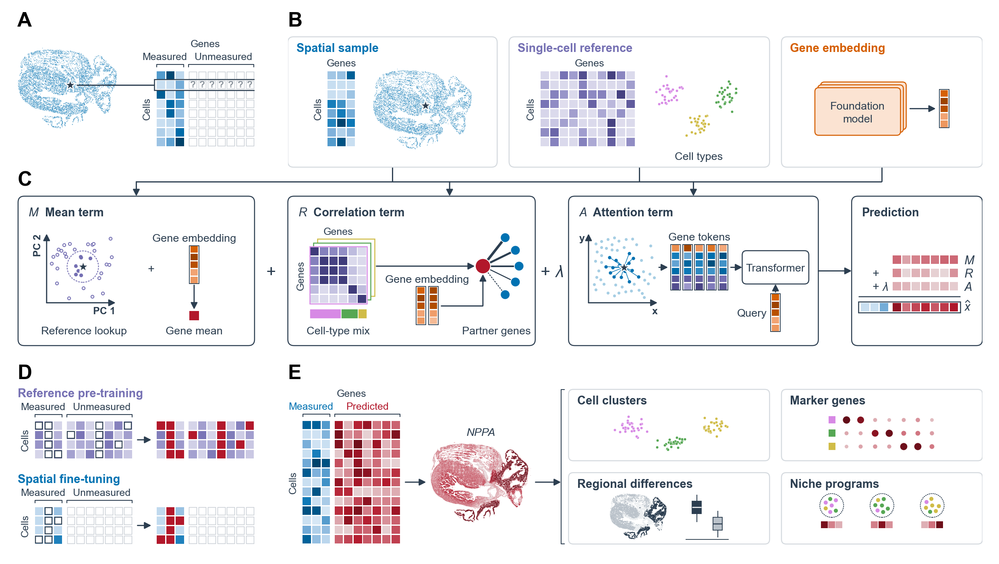

# How the model works

This page summarises the model of the paper (Methods, "Overview of RESONATE", "Model inputs", "The RESONATE model",
"Training and prediction") and names the package setting behind each number. All defaults of
[`resonate.Config`](api/config.md) are the paper settings.

## The task

Each spatial cell $c$ (a segmented cell, spot or bin) has a position, a section label and measured expression
$x_{cg}$ for the panel genes $g \in \mathcal{G}$. A matched single-cell reference measures the panel genes and the
unmeasured genes $\mathcal{U}$ you want to predict. Every gene has a fixed embedding $\mathbf{e}_g$ from a foundation
model (scGPT-spatial by default).

RESONATE learns **one prediction function shared by all genes**. It predicts a gene from the cell's measured profile
and spatial neighbours together with the gene's reference expression and embedding. Because it is trained to
reconstruct masked measured genes and has no gene-specific parameters, it applies unchanged to genes in
$\mathcal{U}$, and to further reference genes after training.

For a spatial cell $c$ and target gene $g$ the prediction is the sum of three terms:

$$
\hat{x}_{cg} \;=\; M_{cg} \;+\; R_{cg} \;+\; \lambda\, A_{cg}.
$$

<strong>Figure 1 (panels C and D).</strong> The mean term, the correlation term and the
attention term, and the two training stages. See the <a href="../">home page</a> for the full caption.

## Model inputs (`resonate.prepare`)

Before training, `prepare` computes everything the terms read. Smoothing and the neighbour searches use measured genes
only.

1. **Normalisation.** Spatial counts are scaled so that each cell's total over the measured genes equals the median
   library size; reference counts so that each cell's total over the panel genes and targets equals $10^4$; then
   $\log(1+x)$.
2. **Smoothed profiles** (following MaxFuse). Each profile is shrunk toward its 15 most similar cells (cosine
   similarity in 30 principal components of the standardised measured profiles), separately among spatial cells and
   among reference cells:
   $$\tilde{\mathbf{x}}_c = 0.3\,\mathbf{x}_c + \frac{0.7}{15}\sum_{c' \in \mathcal{N}^{\mathrm{sm}}(c)} \mathbf{x}_{c'}.$$
   (`smooth_weight`, `k_smooth`)
3. **Reference neighbours.** The $K = 100$ reference cells most similar to $c$ (cosine similarity in 50 principal
   components fitted jointly to the smoothed spatial and reference profiles, each gene standardised within its
   dataset; no batch correction). Their mean is the reference lookup of the mean term.
4. **Reference cell types.** Leiden clusters of the reference: 2,000 highly variable genes, 50 principal components,
   Harmony correction by donor, a 15-neighbour graph, and the resolution chosen to give 15 types within 13 to 18;
   clusters under 50 cells are pooled. (`n_types_target`, `n_types_range`, `min_type_cells`; `prepare(type_key=...)`
   uses given labels instead.)
5. **Cell-type mixture.** The $K = 100$ nearest reference cells of $c$ after Harmony correction with spatial sections
   and reference donors as batches give
   $$p_c(t) = \frac{n_c(t) + \pi_t}{K + 1}, \qquad t^{*}_c = \arg\max_t p_c(t),$$
   where $n_c(t)$ counts neighbours of type $t$ and $\pi_t$ is the share of reference cells of type $t$.
6. **Gene folds.** Measured genes are split at random into 20 folds, and the searches of steps 3 and 5 are repeated
   with each fold left out. Whenever a measured gene is a training target, its lookup and mixture come from the search
   that excludes its fold, so a hidden gene never helps choose the reference cells used to predict it.
7. **Type-specific correlations.** For type $t$ with $n_t$ reference training cells,
   $$\rho_t(g,g') = \frac{n_t\,\rho^{\mathrm{within}}_t(g,g') + 200\,\rho^{\mathrm{pool}}(g,g')}{n_t + 200},$$
   where $\rho^{\mathrm{pool}}$ is the pooled within-type correlation (each gene centred on its type mean). Types with
   fewer than 50 training cells use $\rho^{\mathrm{pool}}$. (`shrink_n0`)

## The three terms (`resonate.fit`)

### Mean term, *M*

$$
M_{cg} = \tfrac12\,\mu_g + \tfrac12\left(\beta_1\,\bar{x}_{cg} + \beta_0\right),
\qquad \mu_g = \mathrm{MLP}_\mu(\mathbf{e}_g),
\qquad \bar{x}_{cg} = \frac{1}{K}\sum_{r \in \mathcal{N}^{\mathrm{ref}}(c)} x^{\mathrm{ref}}_{rg}.
$$

The gene-wide level $\mu_g$ is predicted from the gene's embedding (three hidden layers of 96 units, `mu_hidden`);
$\bar{x}_{cg}$ is the gene's mean over the 100 reference neighbours. $\beta_0, \beta_1$ put the lookup on the
expression scale of the current training stage.

### Correlation term, *R*

$$
R_{cg} = \sum_{t} p_c(t)\,R^{(t)}_{cg}, \qquad
R^{(t)}_{cg} = \sum_{g' \in \mathcal{P}^{+}_{t}(g)} w^{+}_{t,gg'}\,(\tilde{x}_{cg'} - \mu_{g'})
\;-\; \alpha \sum_{g' \in \mathcal{P}^{-}(g)} w^{-}_{t,gg'}\,(\tilde{x}_{cg'} - \mu_{g'}).
$$

The positive partners $\mathcal{P}^{+}_{t}(g)$ are up to 128 measured genes with the strongest positive correlation
$\rho_t(g,g')$ in type $t$ (`n_pos_partners`); the negative partners $\mathcal{P}^{-}(g)$, shared by all types, are up
to 8 measured genes with the most negative correlation across all reference training cells (`n_neg_partners`).
$0 \le \alpha \le 1$ is learned. The partner weights are a softmax over pair scores from one small network
(one hidden layer of 32 units, `corr_hidden`):

$$
w^{\pm}_{t,gg'} = \frac{\exp(\pm\eta_t(g,g'))}{\sum_{g''}\exp(\pm\eta_t(g,g''))}, \qquad
\eta_t(g,g') = \mathrm{MLP}^{(t)}_w\big([\mathbf{e}_g;\,\mathbf{e}_{g'};\,\cos(\mathbf{e}_g,\mathbf{e}_{g'});\,\rho_t(g,g')]\big).
$$

Cell type enters the score through $\rho_t$ and a learned rank-one type-specific addition to the first-layer weights;
all other layers are shared across types and genes.

### Attention term, *A*

$$
A_{cg} = \mathrm{CrossAttn}\Big(\mathbf{q}_g,\; \mathrm{Enc}\big(\{\mathbf{q}_{g'} + \phi(\mathbf{f}_{cg'})\}_{g' \in \mathcal{G}}\big)\Big),
\qquad \mathbf{q}_g = \mathbf{W}\mathbf{e}_g + \mathbf{b}.
$$

Each measured gene $g'$ becomes a token: its projected embedding plus an encoding of its features
$\mathbf{f}_{cg'}$, which hold its unsmoothed expression in $c$ and in the 15 spatial neighbours of $c$ (within the same
section, ordered by distance; `n_spatial_nb`) and one reference-type distance per neighbour (zero for the same assigned
type, otherwise the distance between the two type centroids in the donor-corrected reference, divided by the largest
such distance). A two-layer transformer encoder without positional encoding (width 64, four heads) lets the tokens
interact, and the target embedding queries them. The weight $\lambda$ is chosen from $\{0, \tfrac14, \tfrac12,
\tfrac34, 1\}$ (`lambda_grid`).

## Training

| | stage 1: reference pre-training | stage 2: spatial fine-tuning |
|---|---|---|
| cells | reference, 90 % training / 10 % validation | spatial training / validation cells (`obs["split"]`, or 80/10/10 at random) |
| inputs | panel genes | panel genes |
| targets | panel genes and targets $\mathcal{U}$, plus 256 of 2,000 auxiliary reference genes per batch | panel genes, except a set-aside 20 % |
| checkpoint | mean Pearson over $\mathcal{U}$ in reference validation cells | mean Pearson of the set-aside genes in validation cells, then $\lambda$ |
| batch size, learning rate | 4,096, $4\times10^{-3}$ | 1,024, $2\times10^{-3}$ |

* **Masks.** Each mini-batch hides 5 % of the stage's target genes in every cell (loss weight 0.4) and 20 % drawn
  independently per cell (weight 0.6); the loss is the mean squared error against unsmoothed expression. A hidden gene
  supplies neither a partner nor a token for its own cell. (`mask_frac_batch`, `mask_frac_cell`)
* **Auxiliary targets.** Stage 1 trains the attention term on 2,000 highly variable reference genes outside the panel
  and the targets, 256 per batch, so that it sees more genes than the panel holds. (`n_aux_genes`, `aux_per_batch`)
* **Fixed gene means.** At the start of each stage, the gene-mean network is fitted to per-gene means of that stage's
  training cells and then frozen, because the other terms could otherwise absorb a uniform shift. The lookup
  calibration $(\beta_0, \beta_1)$ is fitted by pooled least squares, once per stage.
* **Set-aside genes.** In stage 2, 20 % of the measured genes, drawn among genes detected in at least 10 % of training
  cells, stay inputs but are never targets. Predicted in validation cells, they select the checkpoint (with
  $\lambda = 1$) and then $\lambda$. (`pseudo_held_fraction`)
* **Optimisation.** Adam, at most 500 epochs, early stopping after 15 epochs without improvement, seed 0.
  (`max_epochs`, `patience`, `seed`)

## Prediction

At inference all measured genes are inputs. Smoothing, reference searches and cell-type mixtures use all spatial
cells, and the spatial-neighbour features use neighbours' measured values whatever their split; trainable parameters,
the lookup calibration and feature standardisation come from training cells. Genes that were not targets during fitting
are predicted by the same trained networks once you pass the reference and the embeddings
([Predict genes outside the panel](tutorials/unseen_genes.md)): the package computes their reference lookup,
type-specific correlations with the panel genes and partner sets, then runs the three terms.

## Settings at a glance

| setting | default | `Config` field |
|---|---|---|
| smoothing weight, neighbours | 0.3, 15 | `smooth_weight`, `k_smooth` |
| spatial neighbours in the attention features | 15 | `n_spatial_nb` |
| positive / negative partners | 128 / 8 | `n_pos_partners`, `n_neg_partners` |
| reference types | 15, within 13 to 18; clusters < 50 cells pooled | `n_types_target`, `n_types_range`, `min_type_cells` |
| correlation shrinkage | $n_0 = 200$ | `shrink_n0` |
| auxiliary genes | 2,000, 256 per batch | `n_aux_genes`, `aux_per_batch` |
| masks | 20 % per cell, 5 % per batch | `mask_frac_cell`, `mask_frac_batch` |
| set-aside genes in stage 2 | 20 % | `pseudo_held_fraction` |
| $\lambda$ grid | 0, 0.25, 0.5, 0.75, 1 | `lambda_grid` |
| epochs, patience, seed | 500, 15, 0 | `max_epochs`, `patience`, `seed` |
| batch size, learning rate | 4,096 and 4e-3 (stage 1); 1,024 and 2e-3 (stage 2) | `stage1_batch_size`, `stage1_lr`, `stage2_batch_size`, `stage2_lr` |
| numerics on CUDA | TF32 matrix multiplies, bf16 inside the attention term | `tf32`, `attn_bf16`, `attn_impl` |

The reference neighbours ($K = 100$) and the 20 gene folds are fixed by the model. The paper adjusted the stage-1 batch
size and learning rate for larger panels (its Supplementary Data 2 lists them per dataset).
