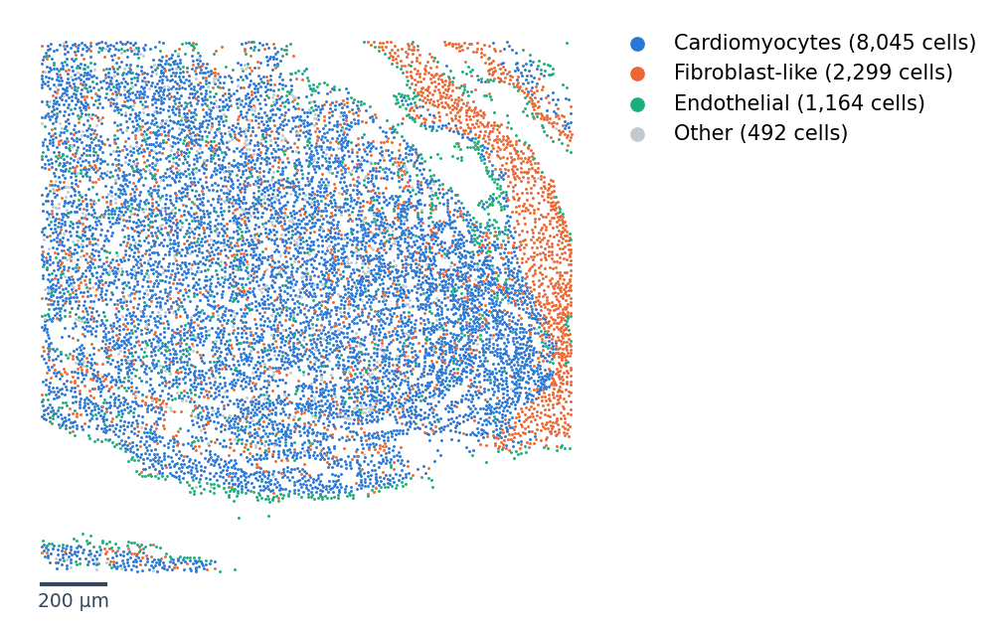
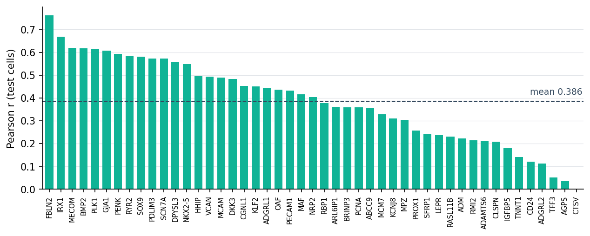
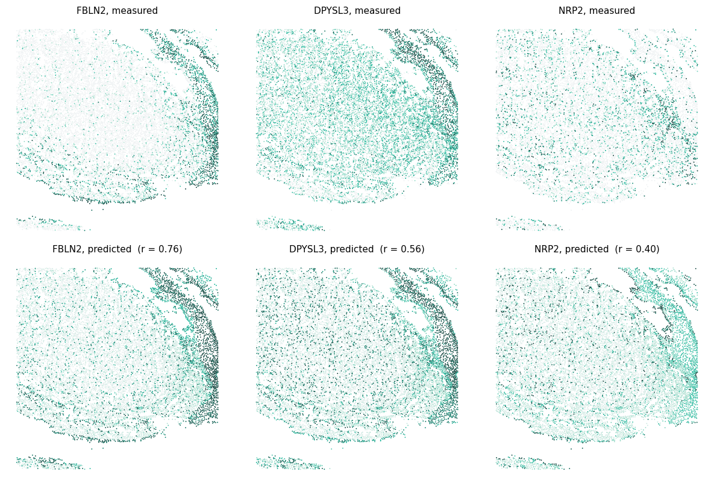

# Quick start on fetal heart

This tutorial runs RESONATE end to end on the [demo data](demo_data.md): a window of a 13-week human fetal-heart
MERFISH section (236-gene panel) and a matched single-cell reference. It hides 48 of the measured genes from the
model, predicts them, and scores the predictions against the measured values, which is how the paper benchmarks the
method. Every step shows the call, what it writes, and the output or figure you should expect.

!!! note "Before you start"
    Install the package ([Installation](../installation.md)) and download the demo data into a folder `data/` next to
    where you run Python ([Demo data](demo_data.md)). The code below runs as written from that folder, in a script or a
    notebook, on a laptop CPU.

!!! tip "Short training for the tutorial"
    The tutorial caps training at 12 epochs per stage so that it finishes in about ten minutes on four CPU cores. All
    other settings are the paper defaults. For a run with the full defaults (up to 500 epochs with early stopping), see
    the note under [Score the held-out genes](#5-score-the-held-out-genes).

## 1. Load the data

```python
import os
import time
import numpy as np
import pandas as pd
import anndata as ad
import matplotlib.pyplot as plt
import resonate

print("resonate", resonate.__version__)

spatial   = ad.read_h5ad("data/fetal_heart_spatial.h5ad")
reference = ad.read_h5ad("data/fetal_heart_reference.h5ad")
emb       = resonate.load_gene_embeddings("data/scgpt_spatial_embeddings_subset.npz")
held_out  = open("data/held_out_genes.txt").read().split()

print(spatial)
print(reference)
print(f"{len(emb)} gene embeddings x {emb.dim} dimensions; {len(held_out)} held-out genes")
print(spatial.obs["split"].value_counts().to_dict())
```

```text title="Output"
resonate 0.1.0
AnnData object with n_obs × n_vars = 12000 × 236
    obs: 'section', 'stage', 'author_fine', 'split'
    obsm: 'spatial'
AnnData object with n_obs × n_vars = 8011 × 2244
    obs: 'donor', 'author_label'
2244 gene embeddings x 512 dimensions; 48 held-out genes
{'train': 9600, 'val': 1265, 'test': 1135}
```

Both objects hold **raw counts**. The spatial object carries cell coordinates in micrometres (`obsm["spatial"]`), a
section label, the authors' cell-type labels (`author_fine`, used here only for plots) and a train / validation / test
split of the cells. The reference carries a donor label (`obs["donor"]`) that RESONATE uses for batch correction. The
embedding table gives one fixed 512-dimensional scGPT-spatial vector per gene. See
[Inputs and outputs](inputs_outputs.md) for the full list of fields.

The window is mostly ventricular. To orient yourself, group the authors' labels into three broad classes and plot them:

??? example "Plotting code"

    ```python
    os.makedirs("resonate_demo/figures", exist_ok=True)
    FIBRO = {"VIC", "vFibro", "aFibro", "EPDC", "Fibro", "Epicardial"}
    ENDO = {"BEC", "VEC", "LEC", "vEndocardial", "aEndocardial", "Endocardial"}

    def broad_type(label):
        """Group the authors' labels (spatial or reference) into four broad classes."""
        if "CM" in label:
            return "Cardiomyocytes"
        if label in FIBRO:
            return "Fibroblast-like"
        if label in ENDO:
            return "Endothelial"
        return "Other"

    groups = spatial.obs["author_fine"].astype(str).map(broad_type).values
    colors = {"Cardiomyocytes": "#2a78d6", "Fibroblast-like": "#eb6834", "Endothelial": "#1baf7a", "Other": "#c4c9cf"}
    xy = spatial.obsm["spatial"]

    fig, ax = plt.subplots(figsize=(6.4, 5.2))
    for name, color in colors.items():
        m = groups == name
        ax.scatter(xy[m, 0], xy[m, 1], s=2, c=color, linewidths=0, label=f"{name} ({m.sum():,} cells)")
    x0, y0 = xy[:, 0].min(), xy[:, 1].min() - 40
    ax.plot([x0, x0 + 200], [y0, y0], color="#33485D", lw=2)
    ax.text(x0 + 100, y0 - 25, "200 µm", ha="center", va="top", fontsize=9, color="#33485D")
    ax.set_aspect("equal")
    ax.axis("off")
    ax.legend(loc="upper left", bbox_to_anchor=(1.0, 1.0), frameon=False, markerscale=5)
    fig.savefig("resonate_demo/figures/sample_overview.png", dpi=150, bbox_inches="tight")
    ```


<div class="figure-caption"><strong>The demo sample.</strong> 12,000 cells of a 13-week fetal-heart MERFISH section
(a square window of about 1.65 mm), coloured by broad classes of the authors' labels. Most cells are ventricular
cardiomyocytes.</div>

## 2. Prepare the model inputs

`prepare` builds everything the model reads. Genes listed in `target_genes` that are also in the spatial panel are
**held out**: they are removed from the spatial input before normalisation, and their measured values are kept aside
for scoring only. Then `prepare` normalises the counts, smooths each profile over similar cells, finds each cell's
100 most similar reference cells, clusters the reference into cell types, gives every spatial cell a mixture over
those types, and computes type-specific gene correlations in the reference.

```python
cfg = resonate.Config(device="cpu", tf32=False, attn_bf16=False, max_epochs=12)

t0 = time.time()
prep = resonate.prepare(spatial, reference, emb, target_genes=held_out, config=cfg)
print(prep)
print(f"prepare: {(time.time() - t0) / 60:.1f} min")
print("reference cell types:", dict(zip(prep.type_names, np.bincount(prep.ref_codes))))
```

```text title="Output"
17:30:48 panel 236 genes = 188 measured + 48 targets (48 held out from the input)
17:30:48 12000 spatial cells (9600/1265/1135 train/val/test), 8011 reference cells, 4 reference batch(es), device cpu
17:30:58 reference cell types (Leiden on Harmony-corrected reference)
17:31:12   leiden resolution 1.0250 -> 24 clusters
17:31:12   leiden resolution 0.5375 -> 18 clusters
17:31:12 type-specific correlations
17:31:12 reference votes
17:31:46 spatial votes
17:32:57 embeddings: 0 of 236 panel genes have none (they share one learnable vector)
17:32:57 auxiliary targets
17:32:57 prepared in 2.1 min
Prepared(12000 spatial cells, 8011 reference cells, 188 measured + 48 target genes, 17 reference types)
prepare: 2.1 min
reference cell types: {'L00': 1323, 'L01': 1136, 'L02': 916, 'L03': 717, 'L04': 606, 'L05': 540, 'L06': 500, 'L07': 490, 'L08': 322, 'L09': 273, 'L10': 236, 'L11': 231, 'L12': 214, 'L13': 188, 'L14': 123, 'L15': 123, 'small': 73}
```

??? abstract "Full log"

    ```text title="Output"
    17:30:48 panel 236 genes = 188 measured + 48 targets (48 held out from the input)
    17:30:48 12000 spatial cells (9600/1265/1135 train/val/test), 8011 reference cells, 4 reference batch(es), device cpu
    17:30:50   lookup fold 1/20
    17:30:50   lookup fold 2/20
    17:30:51   lookup fold 3/20
    17:30:51   lookup fold 4/20
    17:30:52   lookup fold 5/20
    17:30:52   lookup fold 6/20
    17:30:53   lookup fold 7/20
    17:30:53   lookup fold 8/20
    17:30:53   lookup fold 9/20
    17:30:54   lookup fold 10/20
    17:30:54   lookup fold 11/20
    17:30:55   lookup fold 12/20
    17:30:55   lookup fold 13/20
    17:30:56   lookup fold 14/20
    17:30:56   lookup fold 15/20
    17:30:56   lookup fold 16/20
    17:30:57   lookup fold 17/20
    17:30:57   lookup fold 18/20
    17:30:58   lookup fold 19/20
    17:30:58   lookup fold 20/20
    17:30:58 reference cell types (Leiden on Harmony-corrected reference)
    17:31:12   leiden resolution 1.0250 -> 24 clusters
    17:31:12   leiden resolution 0.5375 -> 18 clusters
    17:31:12 type-specific correlations
    17:31:12 reference votes
    17:31:13   reference slot 1/21
    17:31:15   reference slot 2/21
    17:31:17   reference slot 3/21
    17:31:18   reference slot 4/21
    17:31:20   reference slot 5/21
    17:31:22   reference slot 6/21
    17:31:23   reference slot 7/21
    17:31:25   reference slot 8/21
    17:31:27   reference slot 9/21
    17:31:29   reference slot 10/21
    17:31:30   reference slot 11/21
    17:31:31   reference slot 12/21
    17:31:33   reference slot 13/21
    17:31:35   reference slot 14/21
    17:31:36   reference slot 15/21
    17:31:38   reference slot 16/21
    17:31:39   reference slot 17/21
    17:31:41   reference slot 18/21
    17:31:43   reference slot 19/21
    17:31:45   reference slot 20/21
    17:31:46   reference slot 21/21
    17:31:46 spatial votes
    17:31:49   spatial slot 21/21
    17:31:53   spatial slot 1/21
    17:31:56   spatial slot 2/21
    17:32:00   spatial slot 3/21
    17:32:03   spatial slot 4/21
    17:32:06   spatial slot 5/21
    17:32:10   spatial slot 6/21
    17:32:13   spatial slot 7/21
    17:32:17   spatial slot 8/21
    17:32:20   spatial slot 9/21
    17:32:23   spatial slot 10/21
    17:32:27   spatial slot 11/21
    17:32:30   spatial slot 12/21
    17:32:33   spatial slot 13/21
    17:32:37   spatial slot 14/21
    17:32:40   spatial slot 15/21
    17:32:43   spatial slot 16/21
    17:32:46   spatial slot 17/21
    17:32:50   spatial slot 18/21
    17:32:53   spatial slot 19/21
    17:32:56   spatial slot 20/21
    17:32:57 embeddings: 0 of 236 panel genes have none (they share one learnable vector)
    17:32:57 auxiliary targets
    17:32:57 prepared in 2.1 min
    Prepared(12000 spatial cells, 8011 reference cells, 188 measured + 48 target genes, 17 reference types)
    prepare: 2.1 min
    reference cell types: {'L00': 1323, 'L01': 1136, 'L02': 916, 'L03': 717, 'L04': 606, 'L05': 540, 'L06': 500, 'L07': 490, 'L08': 322, 'L09': 273, 'L10': 236, 'L11': 231, 'L12': 214, 'L13': 188, 'L14': 123, 'L15': 123, 'small': 73}
    ```

**Writes** → nothing on disk; `prep` is a [`Prepared`](../api/prepare.md#prepared) object of plain arrays (save it with
`prep.save(...)`, step 6). The reference cell types are Leiden clusters (`L00`, `L01`, ...; clusters under 50 cells are
pooled as `small`); no cell-type labels are needed.

!!! note "Settings"
    `resonate.Config()` holds the paper defaults. Here `device="cpu"` and `tf32=False, attn_bf16=False` select plain
    float32 arithmetic on the CPU, and `max_epochs=12` shortens training. On a GPU, leave `device` unset.

## 3. Fit

`fit` trains in two stages. **Reference pre-training** hides genes in reference cells and learns to reconstruct them,
both panel genes and the held-out genes (the reference measures them). **Spatial fine-tuning** then continues on the
spatial cells and reconstructs hidden measured genes. During fine-tuning, 20 % of the measured genes are set aside: they
stay inputs but are never targets, and their predictions in validation cells choose the checkpoint and the weight
$\lambda$ of the attention term.

```python
t0 = time.time()
model = resonate.fit(prep, cfg)
s1, s2 = model.summary["stage1"], model.summary["stage2"]
print(f"fit: {(time.time() - t0) / 60:.1f} min")
print(f"stage 1: {s1['n_epochs']} epochs (best {s1['best_epoch']}); "
      f"stage 2: {s2['n_epochs']} epochs (best {s2['best_epoch']}); lambda = {s2['lambda_']:g}")
```

```text title="Output"
17:32:59 [stage 1] 8011 reference cells (7209 train / 802 validation); lookup affine a=0.9987 b=-0.0012; mean warm-up loss 0.00007
17:35:29 [stage 2] 9600 train / 1265 validation cells; lookup affine a=0.2988 b=0.1341; 38 of 188 measured genes set aside to select the checkpoint and lambda
17:38:30 [stage 2] lambda on the set-aside genes: 0: 0.3496, 0.25: 0.3496, 0.5: 0.3496, 0.75: 0.3496, 1: 0.3496 -> 0
fit: 5.5 min
stage 1: 12 epochs (best 12); stage 2: 12 epochs (best 2); lambda = 0
```

??? abstract "Full log"

    ```text title="Output"
    17:32:59 [stage 1] 8011 reference cells (7209 train / 802 validation); lookup affine a=0.9987 b=-0.0012; mean warm-up loss 0.00007
    17:33:11   [stage1_reference] epoch   1  train 1.79581  val 0.50569  (12s)
    17:33:24   [stage1_reference] epoch   2  train 1.83605  val 0.50676  (13s)
    17:33:36   [stage1_reference] epoch   3  train 1.84574  val 0.50813  (12s)
    17:33:49   [stage1_reference] epoch   4  train 1.79910  val 0.50894  (13s)
    17:34:01   [stage1_reference] epoch   5  train 1.76605  val 0.50928  (12s)
    17:34:14   [stage1_reference] epoch   6  train 1.72801  val 0.51201  (13s)
    17:34:26   [stage1_reference] epoch   7  train 1.70273  val 0.51338  (12s)
    17:34:39   [stage1_reference] epoch   8  train 1.65609  val 0.51604  (12s)
    17:34:51   [stage1_reference] epoch   9  train 1.90446  val 0.51751  (12s)
    17:35:03   [stage1_reference] epoch  10  train 1.70737  val 0.52102  (12s)
    17:35:16   [stage1_reference] epoch  11  train 1.70225  val 0.52370  (13s)
    17:35:28   [stage1_reference] epoch  12  train 1.67759  val 0.52566  (12s)
    17:35:29 [stage 2] 9600 train / 1265 validation cells; lookup affine a=0.2988 b=0.1341; 38 of 188 measured genes set aside to select the checkpoint and lambda
    17:35:44   [stage2_spatial] epoch   1  train 0.28282  val 0.34909  (15s)
    17:35:59   [stage2_spatial] epoch   2  train 0.23558  val 0.34959  (15s)
    17:36:14   [stage2_spatial] epoch   3  train 0.22472  val 0.34591  (15s)
    17:36:29   [stage2_spatial] epoch   4  train 0.22064  val 0.34422  (15s)
    17:36:44   [stage2_spatial] epoch   5  train 0.20503  val 0.34606  (15s)
    17:36:58   [stage2_spatial] epoch   6  train 0.20881  val 0.34459  (15s)
    17:37:13   [stage2_spatial] epoch   7  train 0.18956  val 0.34617  (15s)
    17:37:28   [stage2_spatial] epoch   8  train 0.18947  val 0.34192  (15s)
    17:37:43   [stage2_spatial] epoch   9  train 0.19271  val 0.34210  (15s)
    17:37:58   [stage2_spatial] epoch  10  train 0.18911  val 0.34211  (15s)
    17:38:13   [stage2_spatial] epoch  11  train 0.19058  val 0.34303  (15s)
    17:38:27   [stage2_spatial] epoch  12  train 0.18631  val 0.34409  (15s)
    17:38:30 [stage 2] lambda on the set-aside genes: 0: 0.3496, 0.25: 0.3496, 0.5: 0.3496, 0.75: 0.3496, 1: 0.3496 -> 0
    fit: 5.5 min
    stage 1: 12 epochs (best 12); stage 2: 12 epochs (best 2); lambda = 0
    ```

**Writes** → nothing on disk; `model` is a fitted [`Resonate`](../api/predict.md) object. `model.summary` and
`model.history` hold the training record.

!!! note "Why λ = 0 here"
    In this small sample the attention term varies very little from cell to cell, so the set-aside genes score the
    same for every λ to four decimals (the last line of the full log); λ = 0 came out marginally highest. With the paper defaults
    on a GPU, the same data gave scores that differ only in the fifth decimal (λ = 1). On the full fetal-heart dataset
    (250,926 cells) the selected λ was 0.25 to 0.75; see [Equivalence with the paper model](../equivalence.md).

## 4. Predict

```python
pred = model.predict()
print(pred)
pred.write_h5ad("resonate_demo/heldout_predictions.h5ad")
```

```text title="Output"
AnnData object with n_obs × n_vars = 12000 × 48
    obs: 'split'
    var: 'is_fit_target'
    uns: 'resonate'
    obsm: 'spatial'
```

**Writes** → `resonate_demo/heldout_predictions.h5ad`: cells (in the order of `spatial`) × the 48 target genes. The
values are on the model's log scale (`log1p` of counts normalised to the median library of the measured genes), not
counts. `obs["split"]` marks train / val / test cells, and `uns["resonate"]["lambda_"]` stores the chosen $\lambda$.

## 5. Score the held-out genes

`score_heldout` compares the predictions with the measured values of the held-out genes in the **test cells**, which
were used neither for fitting nor for checkpoint selection. The headline number is the mean Pearson correlation across
test cells over the *top-N* genes: held-out genes detected in at least 10 % of cells, up to the 100 with the highest
mean count (the paper's scoring rule).

```python
scores = resonate.score_heldout(prep, pred)
for k in ("top_n", "all_heldout"):
    s = scores[k]
    print(f"{k:12s} {s['n_genes']} genes, {s['n_cells']} test cells: Pearson {s['pearson']:.3f}, "
          f"Spearman {s['spearman']:.3f}, aligned MSE {s['mse']:.3f}")

per_gene = pd.DataFrame(scores["top_n"]["per_gene"], index=scores["top_n_genes"])
per_gene = per_gene.sort_values("pearson", ascending=False)
per_gene.to_csv("resonate_demo/per_gene_scores.csv")
print(per_gene.round(3).head(5))
print(per_gene.round(3).tail(3))
```

```text title="Output"
top_n        47 genes, 1135 test cells: Pearson 0.386, Spearman 0.312, aligned MSE 0.259
all_heldout  48 genes, 1135 test cells: Pearson 0.378, Spearman 0.307, aligned MSE 0.254
       pearson  spearman    mse
FBLN2    0.761     0.613  0.294
IRX1     0.669     0.444  0.252
MECOM    0.620     0.457  0.210
BMP2     0.618     0.456  0.172
PLK1     0.615     0.417  0.201
      pearson  spearman    mse
TFF3    0.052     0.055  0.053
AGPS    0.035     0.074  0.099
CTSV    0.002     0.080  0.082
```

**Writes** → `resonate_demo/per_gene_scores.csv` (Pearson, Spearman and aligned MSE of each scored gene).

!!! tip "With the paper defaults"
    Without `max_epochs=12` (early stopping after 15 epochs without improvement), the same benchmark trained for
    91 + 17 epochs, took 23 minutes for `fit` on four CPU cores and scored top-N Pearson 0.388 (Spearman 0.309). On one
    NVIDIA L40S GPU with the paper's GPU numerics it trained for 87 + 16 epochs in under a minute and scored 0.393. The
    paper's model, fitted to the full fetal-heart dataset (250,926 cells, other test cells), scored 0.4395 on the same
    held-out genes; see [Equivalence with the paper model](../equivalence.md).

??? example "Plotting code"

    ```python
    fig, ax = plt.subplots(figsize=(10, 3.4))
    pos = np.arange(len(per_gene))
    ax.bar(pos, per_gene["pearson"], width=0.7, color="#10B396")
    ax.axhline(per_gene["pearson"].mean(), color="#33485D", lw=1, ls="--")
    ax.text(len(per_gene) - 0.5, per_gene["pearson"].mean() + 0.02, f"mean {per_gene['pearson'].mean():.3f}",
            ha="right", va="bottom", fontsize=9, color="#33485D")
    ax.set_xticks(pos, per_gene.index, rotation=90, fontsize=7)
    ax.set_ylabel("Pearson r (test cells)")
    ax.set_xlim(-0.6, len(per_gene) - 0.4)
    ax.spines[["top", "right"]].set_visible(False)
    ax.grid(axis="y", color="#e3e6ea", lw=0.6)
    ax.set_axisbelow(True)
    fig.savefig("resonate_demo/figures/per_gene_pearson.png", dpi=150, bbox_inches="tight")
    ```


<div class="figure-caption"><strong>Accuracy per held-out gene.</strong> Pearson correlation between predicted and
measured expression across the test cells, for each scored held-out gene, sorted. The dashed line is the mean (the
top-N score above).</div>

Maps make the comparison concrete. The held-out genes were hidden from the model in every cell, so measured and
predicted values can be shown over the whole window (the scores above use test cells only):

??? example "Plotting code"

    ```python
    from matplotlib.colors import LinearSegmentedColormap
    from resonate.metrics import truth_log_expression

    ramp = LinearSegmentedColormap.from_list("ramp", ["#eef2f3", "#9fdcc9", "#10B396", "#0b6f5d", "#0b3b35"])
    truth = truth_log_expression(prep)              # measured values of the held-out genes, log scale
    tcol = {g: j for j, g in enumerate(prep.truth_genes)}
    show = list(per_gene.index[[0, len(per_gene) // 4, len(per_gene) // 2]])

    fig, axes = plt.subplots(2, 3, figsize=(11, 7.4))
    for j, g in enumerate(show):
        panels = [(truth[:, tcol[g]], "measured"), (pred[:, g].X.ravel(), "predicted")]
        for i, (vals, what) in enumerate(panels):
            lo, hi = np.percentile(vals, [1, 99])
            order = np.argsort(vals)
            ax = axes[i, j]
            ax.scatter(xy[order, 0], xy[order, 1], c=vals[order], s=1.5, cmap=ramp, vmin=lo, vmax=hi, linewidths=0)
            label = f"  (r = {per_gene.loc[g, 'pearson']:.2f})" if what == "predicted" else ""
            ax.set_title(f"{g}, {what}{label}", fontsize=10)
            ax.set_aspect("equal")
            ax.axis("off")
    fig.tight_layout()
    fig.savefig("resonate_demo/figures/heldout_maps.png", dpi=110, bbox_inches="tight")
    print("genes shown:", show)
    ```

```text title="Output"
genes shown: ['FBLN2', 'DPYSL3', 'NRP2']
```


<div class="figure-caption"><strong>Held-out genes, measured (top) and predicted (bottom).</strong> Three of the scored
genes: the best predicted, the one at the first quartile of the ranking and the median one. Each map's colours span its
own 1st to 99th percentile, darker for higher; the predictions are on the model's log scale, so compare patterns rather
than absolute levels. r is the test-cell Pearson correlation.</div>

## 6. Save and reload

```python
prep.save("resonate_demo/prepared")
model.save("resonate_demo/model")

prep2 = resonate.Prepared.load("resonate_demo/prepared")
model2 = resonate.Resonate.load("resonate_demo/model", prep2, device="cpu")
same = np.allclose(model.predict(as_anndata=False)[0], model2.predict(as_anndata=False)[0], atol=1e-5)
print("same predictions after reload:", same)
```

```text title="Output"
same predictions after reload: True
```

**Writes** → `resonate_demo/prepared/` (`arrays.npz`, `meta.json`) and `resonate_demo/model/` (`model.pt` = the weights,
`model.json` = configuration and training summary). A model is always loaded together with the prepared inputs it was
fitted on.

## Next

* [Predict genes outside the panel](unseen_genes.md): the actual use case, with *NPPA* and *NPPB*.
* [Command line](cli.md): the same workflow without Python.
* Your own data: [Inputs and outputs](inputs_outputs.md) and
  [Choosing a reference and gene embeddings](choosing.md).
