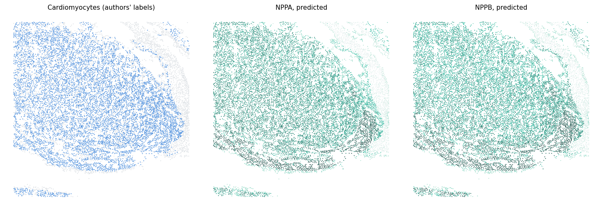

# Predict genes outside the panel

The [quick start](quickstart.md) hid measured genes so that the predictions could be scored. In real use you predict
genes that the spatial panel **never measured**. This page predicts two of them in the demo sample: *NPPA* and
*NPPB*, natriuretic-peptide genes of fetal cardiomyocytes that the 236-gene MERFISH panel does not contain. The paper
uses *NPPA* in fetal heart as one of its biological examples.

There is no measurement of these genes in the spatial data, so nothing can be scored. Instead, the page checks that
the predictions put the genes in the cell classes where the reference expresses them.

!!! note "Before you start"
    Run this from the folder that holds `data/` (see [Demo data](demo_data.md)). It does not need the quick start's
    output. It takes about ten minutes on four CPU cores.

## 1. Load the data and check the genes

A gene can be predicted when it is measured in the reference and has an embedding. It must **not** be in the spatial
panel: panel genes are model inputs.

```python
import os
import time
import numpy as np
import pandas as pd
import anndata as ad
import scanpy as sc
import matplotlib.pyplot as plt
import resonate

spatial   = ad.read_h5ad("data/fetal_heart_spatial.h5ad")
reference = ad.read_h5ad("data/fetal_heart_reference.h5ad")
emb       = resonate.load_gene_embeddings("data/scgpt_spatial_embeddings_subset.npz")

genes = ["NPPA", "NPPB"]
for g in genes:
    print(f"{g}: in spatial panel {g in spatial.var_names}, in reference {g in reference.var_names}, "
          f"has embedding {emb.has(g)}")
```

```text title="Output"
NPPA: in spatial panel False, in reference True, has embedding True
NPPB: in spatial panel False, in reference True, has embedding True
```

## 2. Fit with all measured genes as input

For real predictions, keep the **whole panel** as input and list the unmeasured genes you care about as
`target_genes`. Here we fit with *NPPA* as the target. Nothing is held out, so there is no truth to score.

```python
cfg = resonate.Config(device="cpu", tf32=False, attn_bf16=False, max_epochs=12)

t0 = time.time()
prep = resonate.prepare(spatial, reference, emb, target_genes=["NPPA"], config=cfg, verbose=False)
model = resonate.fit(prep, cfg, verbose=False)
print(prep)
print(f"prepare + fit: {(time.time() - t0) / 60:.1f} min; lambda = {model.summary['stage2']['lambda_']:g}")
```

```text title="Output"
Prepared(12000 spatial cells, 8011 reference cells, 236 measured + 1 target genes, 17 reference types)
prepare + fit: 9.3 min; lambda = 1
```

## 3. Predict the target and further genes, without refitting

`predict()` returns the fit targets. Any other gene of the reference that has an embedding is predicted with the same
trained model when you pass the reference and the embeddings; *NPPB* here was never a target.

```python
t0 = time.time()
unseen = model.predict(["NPPA", "NPPB"], reference=reference, gene_embeddings=emb)
print(unseen)
print(unseen.var)
print(f"predict: {time.time() - t0:.1f} s")
os.makedirs("resonate_demo", exist_ok=True)
unseen.write_h5ad("resonate_demo/unseen_predictions.h5ad")
```

```text title="Output"
AnnData object with n_obs × n_vars = 12000 × 2
    obs: 'split'
    var: 'is_fit_target'
    uns: 'resonate'
    obsm: 'spatial'
      is_fit_target
gene               
NPPA           True
NPPB          False
predict: 11.3 s
```

**Writes** → `resonate_demo/unseen_predictions.h5ad`: cells × genes on the model's log scale.
`var["is_fit_target"]` records which genes were targets during fitting.

!!! tip "Many genes at once"
    Pass a list of hundreds or thousands of reference genes to `predict`; they are processed in chunks of 128
    (`gene_chunk`). Fit targets and other genes can be mixed in one call. Put a gene into `target_genes` when you want
    it modelled during training as well, for example the genes your analysis is about.

A measured gene is refused, because it is an input of the model:

```python
try:
    model.predict(["TBX3"], reference=reference, gene_embeddings=emb)
except ValueError as err:
    print("ValueError:", err)
```

```text title="Output"
ValueError: 1 requested genes are measured in the spatial panel and are model inputs (e.g. ['TBX3']); predict unmeasured genes, or hold the gene out with prepare(target_genes=...)
```

To check how well the model predicts a gene the panel *does* measure, hold it out at `prepare` time, as in the
[quick start](quickstart.md).

## 4. Check the predictions against the reference

The reference measures both genes. Group the authors' labels of the spatial cells and of the reference cells into the
same broad classes and compare the class means. The two columns are on different scales (prediction on the spatial
log scale, reference as `log1p` of counts per 10,000), so compare the order of the classes, not the values.

```python
FIBRO = {"VIC", "vFibro", "aFibro", "EPDC", "Fibro", "Epicardial"}
ENDO = {"BEC", "VEC", "LEC", "vEndocardial", "aEndocardial", "Endocardial"}

def broad_type(label):
    if "CM" in label:
        return "Cardiomyocytes"
    if label in FIBRO:
        return "Fibroblast-like"
    if label in ENDO:
        return "Endothelial"
    return "Other"

sp_group = spatial.obs["author_fine"].astype(str).map(broad_type).values
predicted = pd.DataFrame(unseen.X, columns=unseen.var_names).groupby(sp_group).mean()

ref = reference.copy()
sc.pp.normalize_total(ref, target_sum=1e4)
sc.pp.log1p(ref)
ref_group = ref.obs["author_label"].astype(str).map(broad_type).values
measured = sc.get.obs_df(ref, keys=list(unseen.var_names)).groupby(ref_group).mean()

table = pd.concat({"predicted (spatial)": predicted, "measured (reference)": measured}, axis=1)
table["spatial cells"] = pd.Series(sp_group).value_counts()
print(table.round(2).sort_values(("measured (reference)", "NPPA"), ascending=False).to_string())
```

```text title="Output"
                predicted (spatial)       measured (reference)       spatial cells
gene                           NPPA  NPPB                 NPPA  NPPB              
Cardiomyocytes                 2.73  1.77                 5.73  1.19          8045
Other                          1.99  1.42                 1.85  0.14           492
Fibroblast-like                1.67  1.17                 1.84  0.17          2299
Endothelial                    1.91  1.34                 1.69  0.14          1164
```

Both genes are predicted highest in cardiomyocytes, as the reference measures them. Among the other classes the
predicted differences are small, and their order does not follow the reference.

??? example "Plotting code"

    ```python
    from matplotlib.colors import LinearSegmentedColormap

    ramp = LinearSegmentedColormap.from_list("ramp", ["#eef2f3", "#9fdcc9", "#10B396", "#0b6f5d", "#0b3b35"])
    xy = spatial.obsm["spatial"]
    cm = sp_group == "Cardiomyocytes"

    fig, axes = plt.subplots(1, 3, figsize=(13, 4.6))
    axes[0].scatter(xy[~cm, 0], xy[~cm, 1], s=1.5, c="#d5dadf", linewidths=0)
    axes[0].scatter(xy[cm, 0], xy[cm, 1], s=1.5, c="#2a78d6", linewidths=0)
    axes[0].set_title("Cardiomyocytes (authors' labels)", fontsize=10)
    for ax, g in zip(axes[1:], unseen.var_names):
        vals = unseen[:, g].X.ravel()
        lo, hi = np.percentile(vals, [1, 99])
        order = np.argsort(vals)
        ax.scatter(xy[order, 0], xy[order, 1], c=vals[order], s=1.5, cmap=ramp, vmin=lo, vmax=hi, linewidths=0)
        ax.set_title(f"{g}, predicted", fontsize=10)
    for ax in axes:
        ax.set_aspect("equal")
        ax.axis("off")
    fig.tight_layout()
    os.makedirs("resonate_demo/figures", exist_ok=True)
    fig.savefig("resonate_demo/figures/unseen_maps.png", dpi=110, bbox_inches="tight")
    ```


<div class="figure-caption"><strong>Genes the panel did not measure.</strong> Left: cardiomyocytes by the authors'
labels (blue). Middle and right: predicted <em>NPPA</em> and <em>NPPB</em>, each coloured from its 1st to 99th
percentile, darker for higher. Neither gene is in the MERFISH panel.</div>

!!! warning "A demonstration, not a validation"
    Agreement with the reference shows that the call works and that the predictions follow the reference's cell-type
    pattern. It does not show that the spatial pattern within a class is right. The paper tests predicted
    outside-panel genes against reported regional differences across sections, with a random-gene comparison; see
    the paper's biological analyses before drawing conclusions from single genes.
